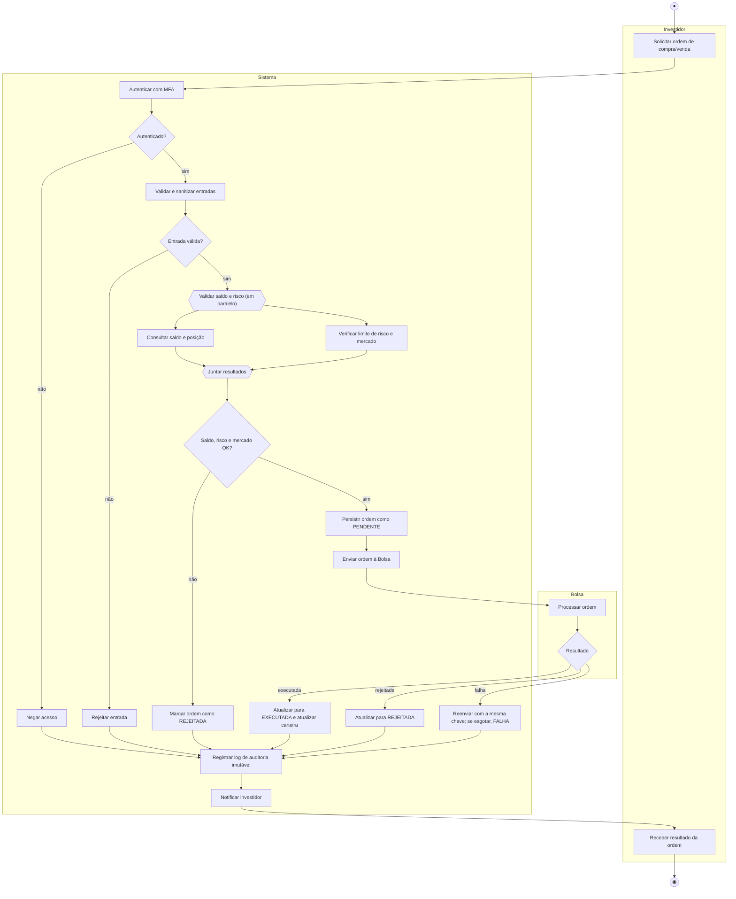
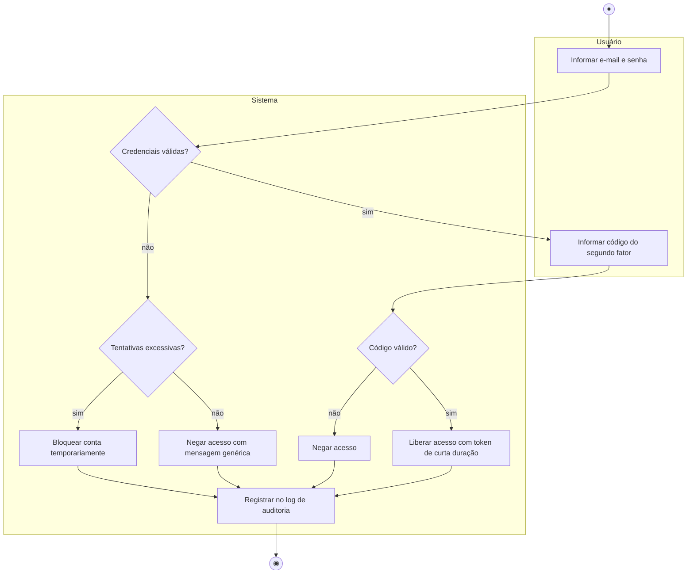

# Diagramas de Atividade — SentinelTrade

Os diagramas de atividade complementam os casos de uso e mostram a lógica interna de cada um: decisões, fluxos de exceção e passos em paralelo. Cada raia (Investidor, Sistema, Bolsa) representa um ator do diagrama de casos de uso.

## 1. Enviar Ordem de Compra/Venda

Caso de uso: **Enviar Ordem de Compra/Venda**, que inclui Autenticar com MFA, Validar Saldo e Risco e Registrar Log de Auditoria Imutável.

**Pontos de segurança (UMLsec):** validação de entrada com allowlist, autenticação com segundo fator, ordem duplicada descartada por chave de idempotência e log append-only com hash do registro anterior.

## 2. Autenticar com MFA

Caso de uso: **Autenticar com MFA**, incluído por Enviar Ordem.

