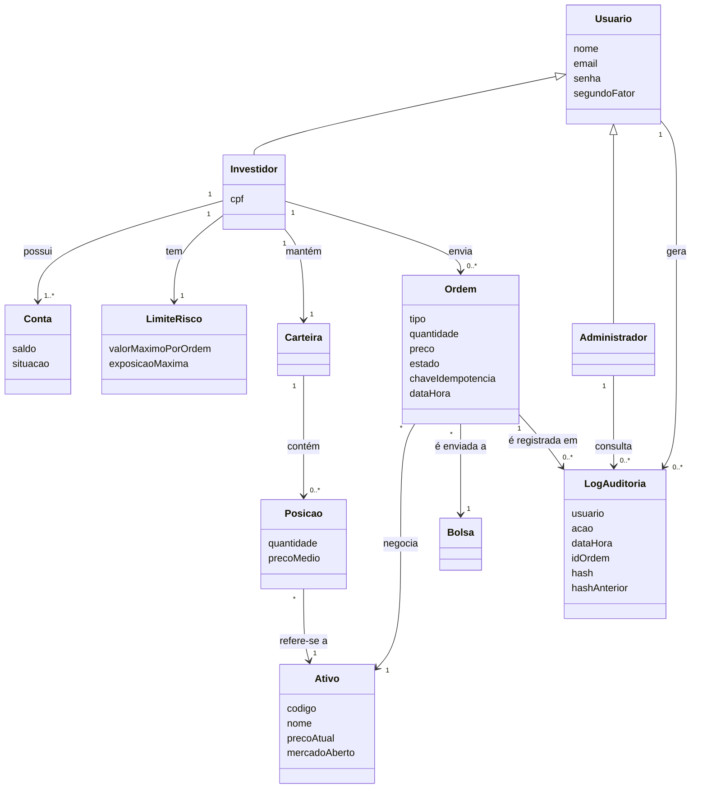

# Diagrama de Classes de Análise — SentinelTrade

Este diagrama mostra **o quê** o sistema precisa conhecer: os conceitos do domínio, seus atributos básicos e os relacionamentos de negócio. Ele não considera tecnologia, linguagem, banco de dados nem detalhes de implementação.

## De onde vem cada classe

| Classe | Origem no projeto |
|--------|-------------------|
| Usuario, Investidor, Administrador | Atores Investidor e Administrador; caso de uso Autenticar com MFA |
| Conta, LimiteRisco | Caso de uso Validar Saldo e Risco (saldo e limite de risco) |
| Carteira, Posicao, Ativo | Validar Saldo e Risco (posição em carteira); texto do projeto ("carteira de ativos") |
| Ordem | Caso de uso Enviar Ordem de Compra/Venda; estados PENDENTE, ENVIADA, EXECUTADA, REJEITADA, FALHA |
| LogAuditoria | Casos Registrar Log de Auditoria Imutável e Consultar Logs de Auditoria |
| Bolsa | Ator Bolsa (corretora simulada) |

## Estados da ordem

`PENDENTE → ENVIADA → EXECUTADA | REJEITADA | FALHA`. Uma ordem reprovada na validação de saldo e risco nasce REJEITADA.
