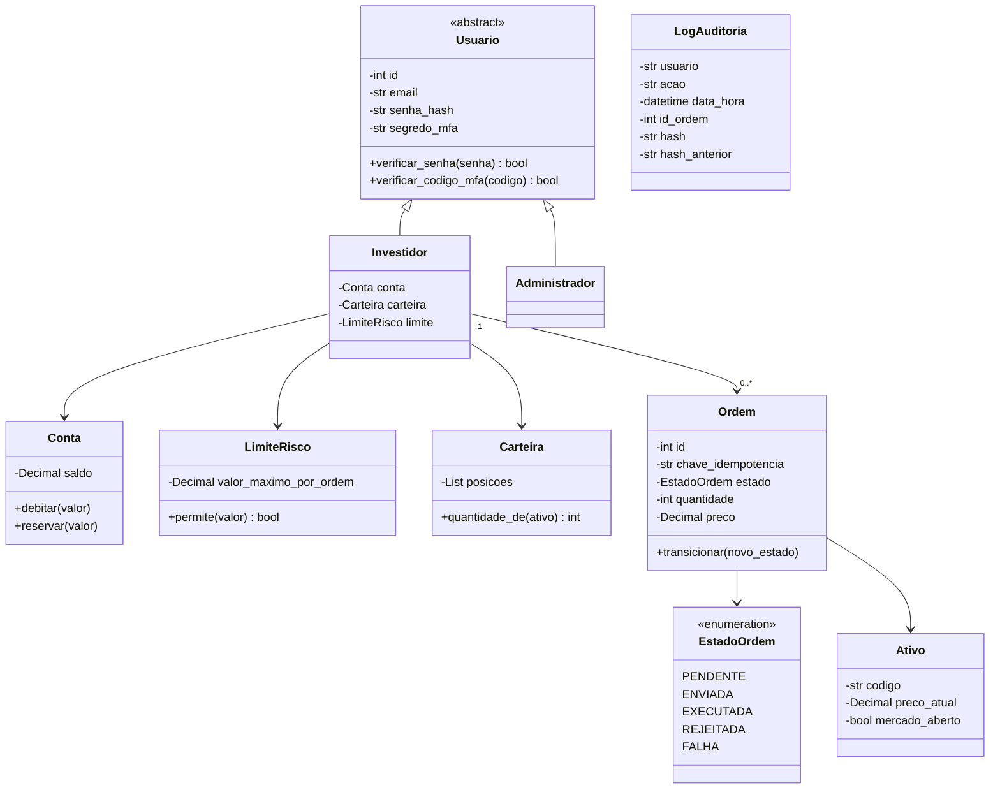
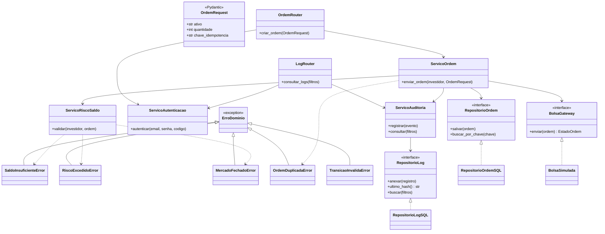

# Diagrama de Classes de Projeto — SentinelTrade

Este diagrama mostra **como** o sistema será construído em Python: separação em camadas (API, serviços de negócio, persistência e integrações), encapsulamento, herança, interfaces (classes abstratas) e tratamento de exceções.

## Camadas

| Camada | Pasta em `src/` | Responsabilidade |
|--------|-----------------|------------------|
| Interface (API) | `api/` | Recebe requisições (FastAPI), valida entradas (Pydantic) e chama os serviços |
| Regras de negócio | `servicos/` | Autenticação com MFA, validação de saldo e risco, envio de ordem, auditoria |
| Domínio | `dominio/` | Entidades e regras de transição de estado |
| Persistência | `persistencia/` | Acesso ao banco SQL com consultas parametrizadas |
| Integrações | `integracoes/` | Bolsa simulada (externa) |

## 1. Domínio (herança, encapsulamento e estados)

## 2. Serviços, interfaces e persistência

## Ligação com os casos de uso

| Caso de uso | Onde é implementado |
|-------------|---------------------|
| Enviar Ordem de Compra/Venda | `OrdemRouter` → `ServicoOrdem` |
| Autenticar com MFA | `ServicoAutenticacao` |
| Validar Saldo e Risco | `ServicoRiscoSaldo` |
| Registrar Log de Auditoria Imutável | `ServicoAuditoria` → `RepositorioLog` (append-only, com hash do registro anterior) |
| Consultar Logs de Auditoria | `LogRouter` → `ServicoAuditoria` |

## Requisitos do enunciado atendidos

| Requisito | Como aparece no projeto |
|-----------|-------------------------|
| Encapsulamento | Atributos privados (`-`) nas entidades |
| Herança | `Usuario` → `Investidor` e `Administrador`; `ErroDominio` → erros específicos |
| Interfaces ou classes abstratas | `RepositorioOrdem`, `RepositorioLog`, `BolsaGateway`, `Usuario` |
| Separação entre interface, regras, persistência e integrações | As camadas da tabela do início |
| Tratamento seguro de exceções | Hierarquia `ErroDominio` |
| Transição de estados de ordem | `Ordem.transicionar` com `EstadoOrdem` |
| Prevenção de duplicidade | `chave_idempotencia` e `buscar_por_chave` |
| Logs de auditoria imutáveis | `RepositorioLog` só com `anexar` (sem alterar nem apagar) |
